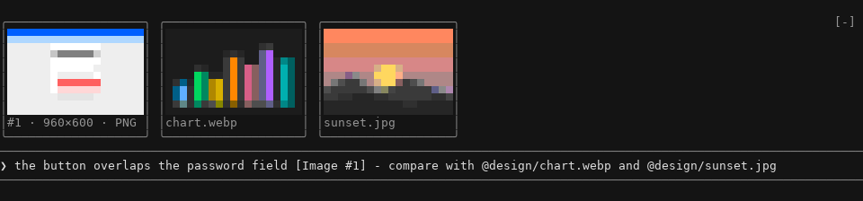
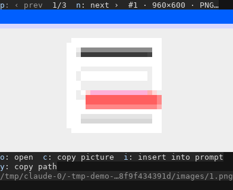

# Image Preview for Claude Code

[](https://github.com/JonasR-Git/claude-image-preview/actions/workflows/ci.yml)
[](https://github.com/JonasR-Git/claude-image-preview/releases)
[](LICENSE)

See the pictures in your prompt before you send them. Image Preview draws small thumbnails right above the
Claude Code prompt for every picture the prompt carries: pasted screenshots (`[Image #1]`), `@`-mentioned image
files and pictures taken straight from the clipboard. It also adds a gallery of everything the session has seen,
pasting and copying pictures through the system clipboard, and a thumbnail under every picture Claude reads.

It runs on **Windows, macOS, Linux and WSL**, needs no Node, Python or native add-on, and decodes PNG, JPEG, GIF,
BMP and WebP itself. On Windows, where no terminal can show pictures to Claude Code, it lays the real picture
over its thumbnail, at full resolution.



## Requirements

- **Claude Code in a terminal** (the CLI), version 2.1.296 or later: the plugin is a mod, which needs a recent
  Claude Code. The desktop app, the IDE extensions and the web keep their own previews; it draws nothing there.
- **Windows 10 or 11** (Windows PowerShell 5.1 comes with it), **macOS**, **Linux** or **WSL**. Nothing else to
  install; on Linux a clipboard tool and a converter are optional (see [Platforms](#platforms)).

## Install

In Claude Code:

```
/plugin marketplace add JonasR-Git/claude-image-preview
/plugin install image-preview@jonasr-plugins
```

or from a shell:

```sh
claude plugin marketplace add JonasR-Git/claude-image-preview
claude plugin install image-preview@jonasr-plugins
```

Restart Claude Code (or run `/reload-plugins`).

### Check that it works

Paste a screenshot into the prompt, or type `@` and the path of a picture: a thumbnail appears above the prompt
within a quarter of a second. If none does, `/image-preview status` says what the plugin found.

On Windows the first session compiles the overlay helper, which takes a few seconds once; from then on the sharp
picture lies over its thumbnail right after a paste.

### Update and uninstall

```sh
claude plugin marketplace update jonasr-plugins
claude plugin update image-preview@jonasr-plugins      # then restart Claude Code

claude plugin uninstall image-preview@jonasr-plugins
claude plugin marketplace remove jonasr-plugins
```

The plugin keeps a cache of converted thumbnails and, on Windows, its compiled helper in
`%LOCALAPPDATA%\claude-image-preview` (macOS: `~/Library/Caches/claude-image-preview`, Linux:
`~/.cache/claude-image-preview`). Delete that folder after uninstalling to remove every trace.

## What it does

| Feature                     | How                                                                                                                        |
| --------------------------- | -------------------------------------------------------------------------------------------------------------------------- |
| Thumbnails above the prompt | Appear as soon as a picture is pasted or mentioned, disappear when the prompt is sent or the reference is deleted.         |
| Pastes                      | `[Image #n]` placeholders are matched to the file Claude Code stored, including after `/resume`.                           |
| Mentions                    | `@shot.png`, `@"My Pictures/a b.jpg"`, `@~/Desktop/x.webp`, relative or absolute.                                          |
| Paste from the clipboard    | `/paste` inserts the picture on the clipboard as an `@`-mention. Copied image files (Explorer, Finder, file managers) too. |
| `@clipboard`                | Type `@clipboard` anywhere in a prompt: it is sent as the picture on the clipboard. The typeahead offers it from `@cli`.   |
| Copy to the clipboard       | `/image-copy #2` puts a picture on the clipboard as an image, ready to paste into a chat, ticket or document.              |
| Gallery                     | `/images` opens a pane with every picture of the session: step through, open, copy, insert into the prompt, copy path.     |
| Open in a viewer            | `/image-open #1` opens the picture in the system's default viewer.                                                         |
| Pictures Claude reads       | A screenshot Claude opens with the Read tool gets a small thumbnail under its result and lands in the gallery.             |
| Status                      | Missing files, unsupported formats and pictures still being written are named in place of the thumbnail.                   |
| Dropped files in Git Bash   | A picture dragged into Git Bash arrives as a POSIX path; the paste is turned into an `@`-mention Claude Code attaches.     |
| Diagnostics                 | `/image-preview status` shows platform, renderer, where pastes are found and which helper tools exist.                     |

Each thumbnail has a title row: its label opens it in the gallery, the ✕ takes it out of the prompt. The
other thumbnails keep their size for five seconds after a ✕, so several can be taken out in a row without
the band jumping. On
Windows, where the real picture lies over the blocks, a click on the picture opens it in the default viewer.

### Commands

| Command                                     | Does                                                                                         |
| ------------------------------------------- | -------------------------------------------------------------------------------------------- |
| `/paste`                                    | Insert the clipboard's picture (or copied picture files) into the prompt at the cursor.      |
| `/images [#n]`                              | Open the gallery, optionally at paste `#n`.                                                  |
| `/image-copy [#n \| path]`                  | Copy a picture to the clipboard as an image. Without an argument: the newest picture.        |
| `/image-open [#n \| path]`                  | Open a picture in the default viewer. Without an argument: the newest picture.               |
| `/image-preview on \| off`                  | Show or hide the thumbnails for this session.                                                |
| `/image-preview pictures \| blocks \| auto` | Force real pictures, force colored blocks, or let the plugin detect what the terminal draws. |
| `/image-preview status`                     | Diagnostics.                                                                                 |



In the gallery, `p` and `n` step through the pictures; `o` opens the one shown, `c` copies it as a picture,
`i` inserts it into the prompt and `y` copies its path. Every key is also a button you can click.
`Esc` closes the gallery.

### Formats

Decoded by the plugin itself, on every platform:

- **PNG**: every color type and bit depth, transparency, interlaced (Adam7).
- **JPEG**: baseline and progressive, any subsampling, CMYK/YCCK, EXIF orientation.
- **GIF**: first frame, transparency.
- **BMP**: 1 to 32 bit, bitfields, RLE.
- **WebP**: lossy, lossless, alpha, and the first frame of animated files.

Through a converter the system already has, when available: **HEIC/HEIF, AVIF, TIFF, ICO** and files over 4 MB.
On Windows that is the Windows Imaging Component (via PowerShell), on macOS `sips`; on Linux any of ImageMagick
(`magick`/`convert`), libvips (`vipsthumbnail`), `dwebp` or `ffmpeg`. SVG files are named, not drawn.

## Settings

Set under `/plugin` → Image Preview → Configure options, or in `~/.claude/settings.json`:

```json
{
  "pluginConfigs": {
    "image-preview@jonasr-plugins": { "options": { "tile_rows": 12, "overlay": false } }
  }
}
```

| Setting         | Values                              | Default |                                                                          |
| --------------- | ----------------------------------- | ------- | ------------------------------------------------------------------------ |
| `renderer`      | `auto`, `pictures`, `blocks`, `off` | `auto`  | How thumbnails are drawn. `off` turns the band above the prompt off.     |
| `tile_rows`     | 2 – 32                              | 32      | Rows a thumbnail may take. Thumbnails shrink when the row would not fit. |
| `overlay`       | on / off                            | on      | Windows: the real picture laid over its colored blocks.                  |
| `read_previews` | on / off                            | on      | Thumbnails under pictures Claude reads, and those pictures in /images.   |

The environment variable `IMAGE_PREVIEW_RENDERER` (`pictures`, `blocks`, `auto`, `off`) overrides `renderer`,
handy for one terminal profile.

`renderer: off` turns the band off for good: no polling, no overlay helper; the gallery, the commands and the
Read thumbnails stay. `/image-preview off` only hides the band for the current session, and
`/image-preview on` shows it again.

## Terminals

Three ways to draw:

- **Pictures**: real pixels, where Claude Code can draw images in the terminal (kitty, Ghostty and terminals with
  the same graphics protocol).
- **Colored blocks**: two pixels per character cell in 24-bit color. Works in every terminal with true color:
  Windows Terminal, iTerm2, WezTerm, VS Code's integrated terminal, Alacritty, GNOME Terminal, inside tmux and
  over SSH.
- **Real pictures over the blocks** (native Windows only, not WSL): no Windows terminal speaks the protocol
  Claude Code draws pictures with, so a helper finds each tile's frame on screen and lays a borderless window
  with the picture, at full resolution, exactly over its blocks. It takes no focus, opens the picture on a
  click, passes the mouse wheel on, follows the window and hides when another one is in front, its tab is not
  shown or it is scrolled back. `overlay` turns it off.

| Windows terminal              | How the helper finds the cells                                   |
| ----------------------------- | ---------------------------------------------------------------- |
| Console (`cmd`, `conhost`)    | the console's font and window                                    |
| Git Bash (mintty)             | mintty's window, whole cells inside a one-pixel padding          |
| Windows Terminal              | UI Automation: the screen rectangle of its first character; tabs |
| VS Code's integrated terminal | the tile frames on a screenshot of the window (dark themes)      |
| WezTerm, Alacritty            | the tile frames on a screenshot of the window                    |
| others                        | the same two ways; where neither works, the blocks stay          |

All of them were tried on Windows 11 with Claude Code 2.1.296.

With `auto` the plugin starts from the terminal's name and then asks Claude Code whether a picture really showed.
If it did not (tmux, an SSH hop, a terminal that only claims support) it switches to colored blocks by itself.
Over SSH, pictures are sent as pixels instead of file paths.

The desktop app, the IDE extensions and the web keep their own image previews; the plugin draws nothing there.

## Platforms

| Platform | Clipboard                                                                 | Pastes found in                       |
| -------- | ------------------------------------------------------------------------- | ------------------------------------- |
| Windows  | PowerShell (built in), pixels and copied files                            | `%TEMP%\claude\…`                     |
| macOS    | AppKit through `osascript` (built in), pixels and copied files            | `$TMPDIR/claude-<uid>/…`              |
| Linux    | `wl-paste`/`wl-copy` on Wayland, `xclip` on X11                           | `$TMPDIR` or `/tmp`, `claude-<uid>/…` |
| WSL      | the Windows clipboard through `powershell.exe`, paths mapped by `wslpath` | the Linux temp folder                 |

`CLAUDE_CODE_TMPDIR` is honored everywhere. Paths with spaces, non-ASCII user names and long project paths work.

On Linux, install `wl-clipboard` (Wayland) or `xclip` (X11) for `/paste`, `@clipboard` and `/image-copy`.
Everything else works without them.

## Privacy and security

- The plugin makes no network requests and never sends anything to the model on its own: a picture reaches
  Claude only when you send a prompt that mentions it. A Git Bash drop is rewritten into such a mention in the
  prompt box, where you see it before sending.
- It reads the files your prompt names, Claude Code's own paste folder, the pictures Claude reads (unless
  `read_previews` is off) and the clipboard when you ask for it (`/paste`, `@clipboard`). Network paths
  (`\\server\share\…`) are never opened, so a mention cannot make Windows send your credentials to a server.
- Converters get only files whose first bytes, or past 4 MB whose name, mark them as pictures; ImageMagick is told
  the format, and `ffmpeg` may read local files only. `/image-open` and a click on a picture open only local
  picture files.
- On Windows the overlay helper reads the terminal's characters and, where the terminal tells nothing of its
  cells (VS Code, WezTerm, Alacritty), takes screenshots of the terminal window while thumbnails show, to find
  the tile frames. They stay in memory and are never written or sent anywhere. `overlay` turns this off.
- It writes only to its own folder in your user cache (`%LOCALAPPDATA%\claude-image-preview`,
  `~/Library/Caches/claude-image-preview`, `~/.cache/claude-image-preview`), one subfolder per session:
  clipboard captures, converted thumbnails and, on Windows, the overlay helper's tile list and log; the
  compiled helper sits one level up. It is a folder only your account can write to, since the helper kept
  there is loaded and run. Session folders older than three days are removed at start.
- Programs it may start: `powershell`/`powershell.exe` (Windows, WSL), `osascript` and `sips` (macOS),
  `wl-paste`, `wl-copy`, `xclip`, `xdg-open`, `wslpath`, `wslview` and the converters listed above (Linux), and
  `uname`, `id` and `getconf` to find the temp folder. On Windows one PowerShell process runs for the whole
  session: the overlay helper, which reads the console's characters and never writes to it. Arguments are
  passed as lists; file paths never go through a shell string, and PowerShell scripts are passed encoded.
- Environment variables read: `OS`, `WSL_DISTRO_NAME`, `WSL_INTEROP`, `TMPDIR`, `TMP`, `TEMP`,
  `CLAUDE_CODE_TMPDIR`, `LOCALAPPDATA`, `HOME`, `XDG_CACHE_HOME`, `USERPROFILE`, `TERM`, `TERM_PROGRAM`, `TMUX`, `STY`,
  `KITTY_WINDOW_ID`, `GHOSTTY_RESOURCES_DIR`, `CLAUDE_CODE_FORCE_TERMINAL_IMAGES`, `CLAUDE_CODE_SESSION_KIND`,
  `WAYLAND_DISPLAY`, `DISPLAY`, `SSH_CONNECTION`, `IMAGE_PREVIEW_RENDERER`.

## Troubleshooting

Run `/image-preview status` first: it says what the plugin found.

- **No thumbnails at all**: the band shows only in the terminal and only while the prompt names a picture. Check
  that the plugin is enabled (`/plugin`) and that `renderer` is not `off`.
- **A paste shows "…" and then "not found"**: the plugin did not find the file Claude Code stored. Run
  `/image-preview status` while the tile shows it: the report names the temp folders searched, the `claude-<uid>`
  folders found, this session's paste folder and, when that is missing, the paste folders other sessions wrote
  to lately. Please include it when you open an issue.
- **Empty boxes or garbled cells**: the terminal lacks true color or picture support. Use
  `/image-preview blocks`, or a terminal with 24-bit color.
- **Windows: blocks but no real picture over them**: `/image-preview status` names the overlay's state and its
  log (`overlay.log`). Pictures show only while the terminal is in front and its tile is fully on screen. In
  VS Code a light theme can recolor the frames so the helper does not find them. Where PowerShell scripts are
  blocked by policy (`Constrained Language Mode`, AppLocker), the helper cannot start; the blocks stay.
- **`/paste` says no clipboard tool**: install `wl-clipboard` or `xclip` (Linux).
- **HEIC/AVIF show "unsupported"**: install ImageMagick or libvips (Linux); Windows needs the HEIF/AV1
  extensions from the Microsoft Store.

### Known limitations

- Claude Code draws real pictures only in kitty and Ghostty; everywhere else the band shows colored blocks,
  and on Windows the overlay lays the real picture over them.
- The overlay is a separate window: in a screen share or a recording that captures only the terminal window,
  the blocks show, not the picture.
- On Windows the thumbnails in the transcript (under a Read result) stay colored blocks: they scroll with the
  transcript, which a window laid over them could not follow.
- Animated GIF and WebP files show their first frame. SVG files are named, not drawn.

Found a bug? Please [open an issue](https://github.com/JonasR-Git/claude-image-preview/issues) with the output
of `/image-preview status`.

## Development

```sh
git clone https://github.com/JonasR-Git/claude-image-preview
cd claude-image-preview
claude --plugin-dir .           # load it into a session; edits reload when a turn ends
claude plugin validate --strict .
claude plugin test .
npx -p typescript tsc -p .      # needs .claude-plugin/types/, written when Claude Code first loads the folder
npx prettier@3.5.3 --check .
```

The code is TypeScript run directly by Claude Code; there is no build step and no dependency to install.
`docs/ARCHITECTURE.md` describes the layers, [CONTRIBUTING.md](CONTRIBUTING.md) how to send a change. Test
fixtures are generated by `scripts/make-fixtures.py` (Pillow) and checked in.

## License

[MIT](LICENSE) © JonasR
